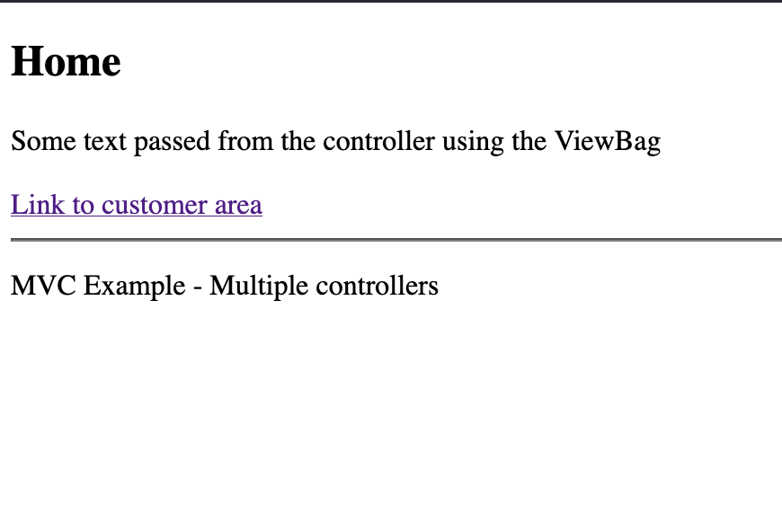
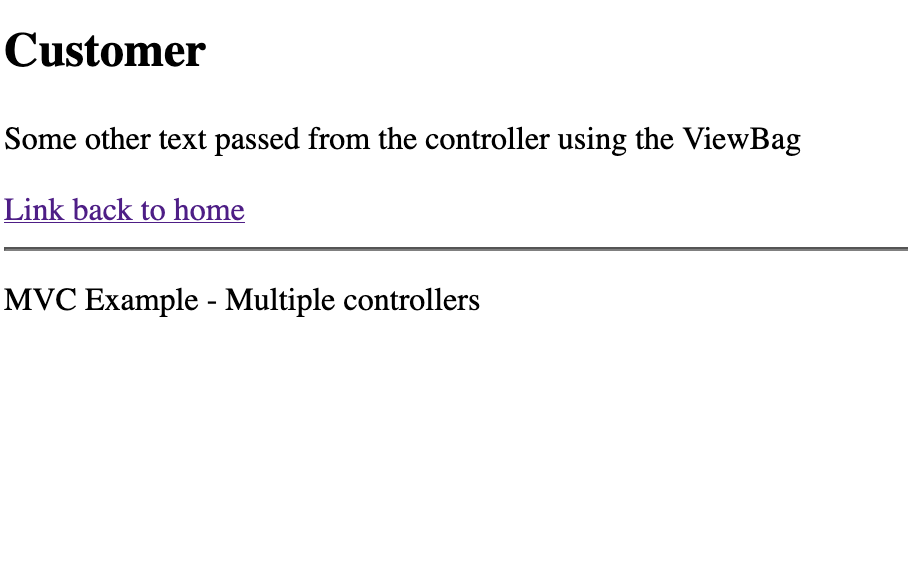
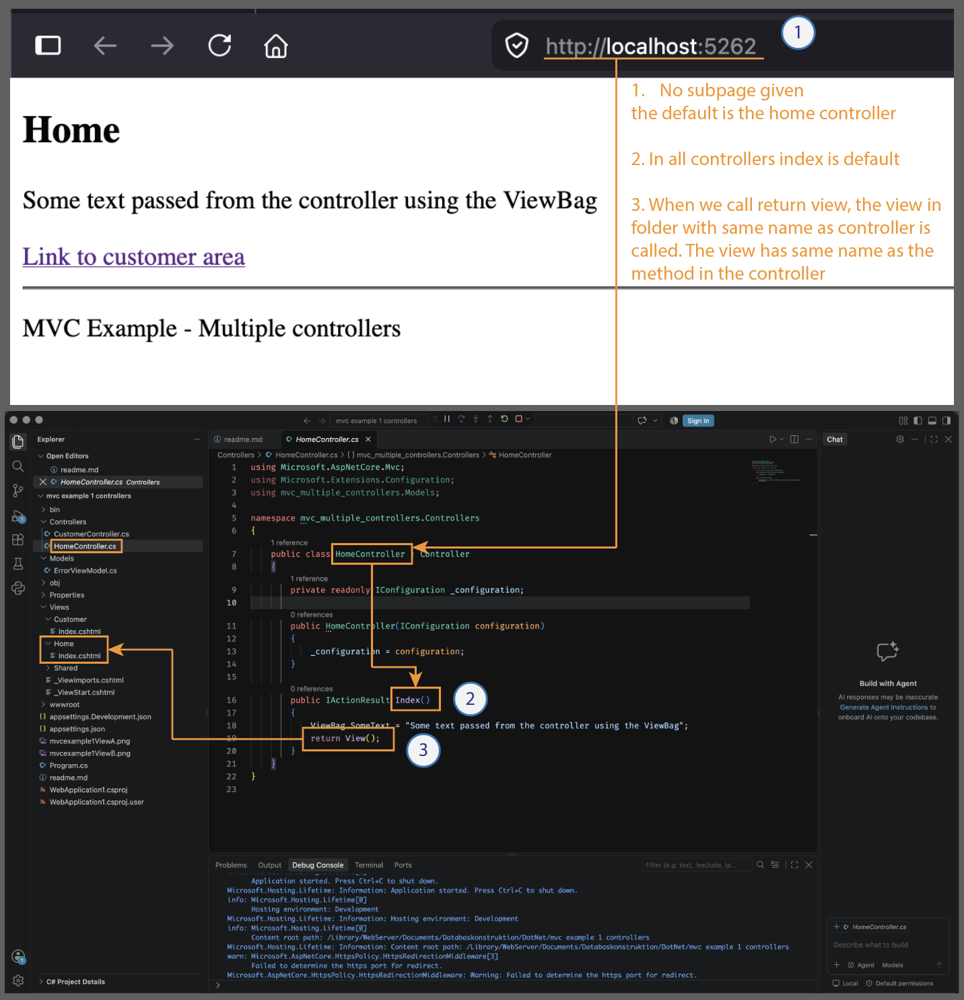
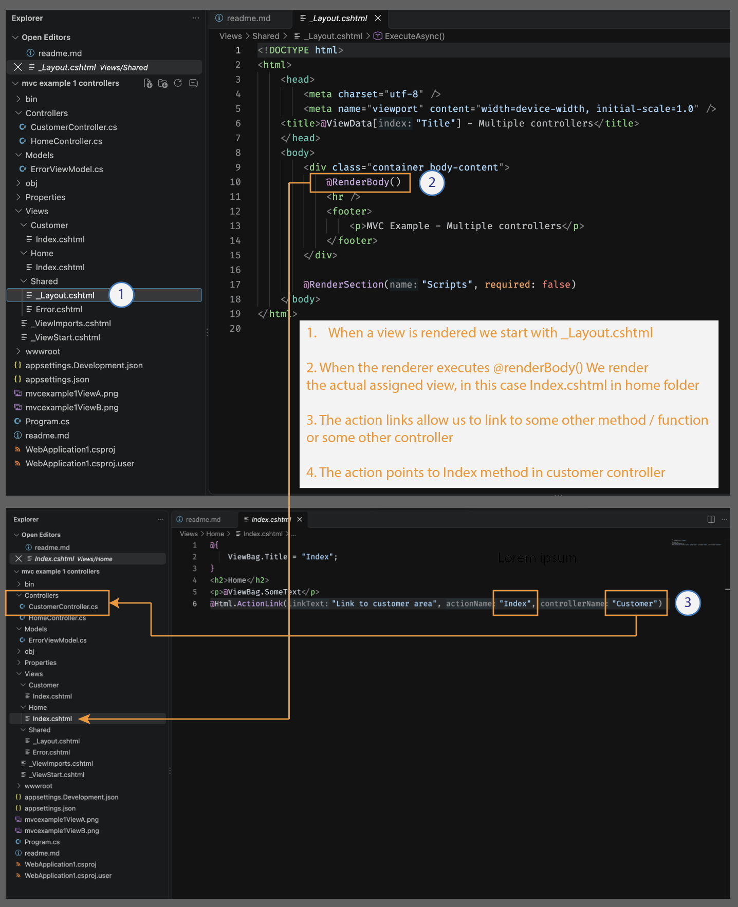
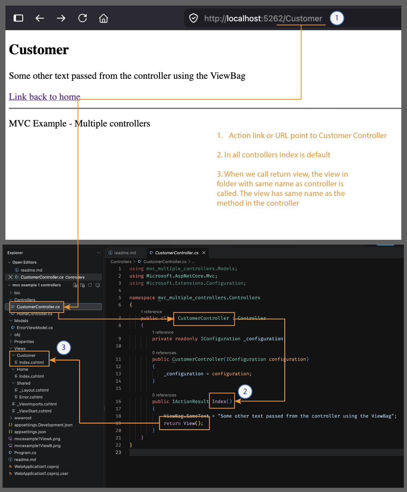

### Overview
This example shows how to make application that has more than one controller and uses action links to go from one controller to the other.

## View

In the view we show the information sent from the controller. The action link will navigate to the Index function on the Customer controller.

```html
@{
    ViewBag.Title = "Index";
}
<h2>Home</h2>
<p>@ViewBag.SomeText</p>
@Html.ActionLink("Link to customer area", "Index", "Customer")
```

## Controller

In the controller for the index page, we read the customers from the model and pass that data to the view using the ViewBag.

```c#
public IActionResult Index()
{
    ViewBag.SomeText = "Some other text passed from the controller using the ViewBag";
    return View();
}
```

## Model

In the first example we have no database / data and therefore no model

## Screenshots

The application when executed looks like this




## Detail figures

In the first figure we start execution through the default link
1. We start in default controller "home"
2. We go to default method "index" in home controller
3. We render the view. Which is "index.cshtml" in "home" view folder



The second figure shows the execution process of a view (in this case index.cshtml in home folder)
1. When any view is rendered we first render the _layout.cshtml in the shared folder. This way all pages can have for example the same top menu or headers / footers etc.
2. When we arrive at RenderBody the specific view is run (in this case index.cshtml in home folder)
3. The view is rendered with mostly normal html tags. An action link is used which links to the index method in the customer controller.



In the last figure we show the rendering of the second controller "customer"
1. We arrive at CustomerController.cs since this cs file contains the CustomerController class
2. We run the index (default) method in the customer controller
3. We run the index.cshtml view in the customer folder. 

